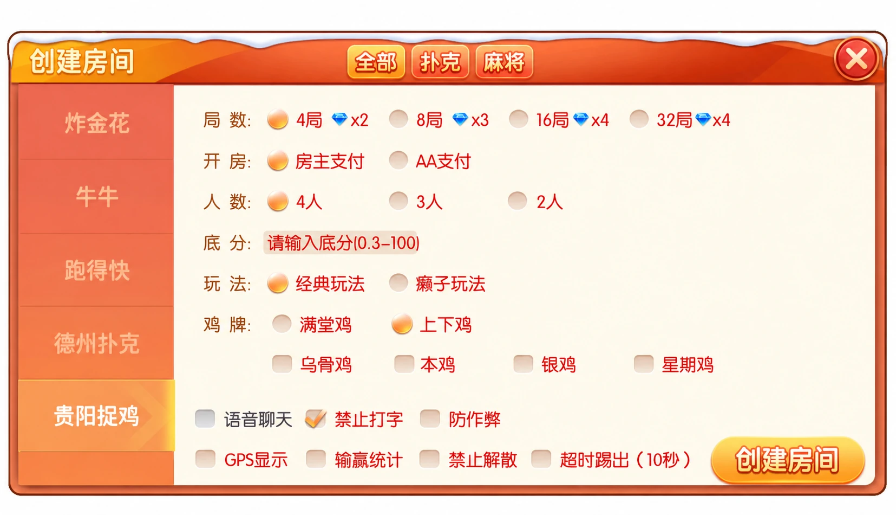

# 微友麻将：大厅布局与房间选项状态

微友麻将的大厅使用节庆灯笼、舞狮造型与橙紫配色，将俱乐部、加入房间和创建房间放在右侧。玩法配置中可见贵阳捉鸡及跑得快等入口。本文选择大厅和麻将配置两种画面，讨论界面选项如何表达。

## 大厅

俱乐部按钮占据主要位置，加入与创建房间紧随其后。规则、战绩、邮件与客服位于底部，帮助用户从主任务进入辅助信息。


## 麻将房间配置

贵阳捉鸡页面将局数、人数、玩法和鸡牌选项分行展示。圆形选择控件适合表达同组互斥选择，方形控件适合表达可组合的开关。页面上的费用和数值属于原界面信息，本文不实现支付或结算。



配图经AI整理模拟器边框及账号展示信息；配置图仅展示弹窗区域。图片用于界面讨论，不代表原软件功能被修改。

## 单选与多选分开保存

单选模式可以存为一个字符串，多选开关可以存为一个集合。把两者都当作普通数组，会增加重复项和相互冲突状态的可能。下面是独立教学示例，字段用于说明方法，并非原项目协议。

```js
// 独立示例：单选值与多选集合的更新。
const modes = new Set(['classic', 'wildcard']);
const allowedFlags = new Set(['voice', 'blockTyping']);
export function updateOptions(state, key, value) {
  if (!state || !modes.has(state.mode) || !Array.isArray(state.flags) ||
      state.flags.some(flag => !allowedFlags.has(flag)))
    throw new TypeError('无效状态');
  const flags = new Set(state.flags);
  if (key === 'mode') {
    if (!modes.has(value)) throw new TypeError('未知模式');
    return {mode:value, flags:[...flags]};
  }
  if (!allowedFlags.has(key) || typeof value !== 'boolean')
    throw new TypeError('无效开关');
  value ? flags.add(key) : flags.delete(key);
  return {mode:state.mode, flags:[...flags]};
}
```

模式变更直接替换旧值；开关启用时加入集合，关闭时移除。重复启用不会产生两个同名选项。函数返回新对象，避免界面不同区域共用状态时出现隐式修改。

尤其要注意布尔值校验：字符串`'false'`并不等于布尔值`false`，不能用简单的真假判断代替输入检查。正式系统还应在提交时验证选项组合，前端控件是否选中不能代替服务端校验。截图无法说明防作弊、定位或语音功能的实际实现，本文不作推断。

## 示例验证

运行`node test.mjs`验证9项断言，包括互斥替换、多选去重、关闭开关、不可变输入和无效值。文件：[example.mjs](example.mjs)、[test.mjs](test.mjs)。本仓库仅提供技术文章和独立示例，没有第三方游戏工程。

## 技术交流

[Telegram @root4433](https://t.me/root4433)
